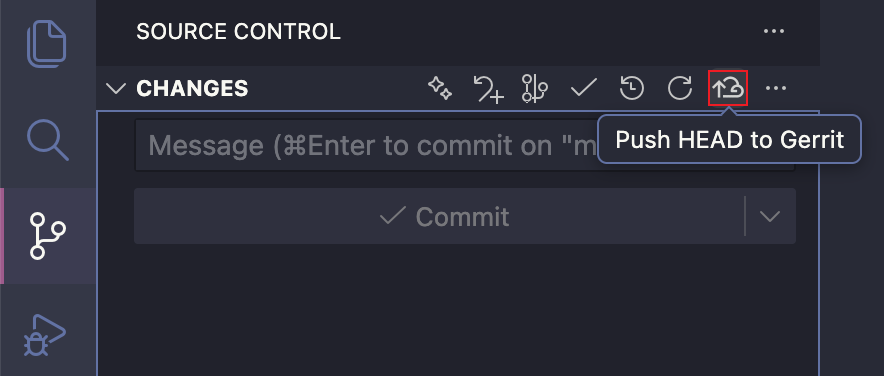

# Gerrit Push Button

Adds Gerrit workflow actions to VS Code Source Control: push `HEAD` to `refs/for/<branch>` for review or apply a Gerrit patch to the current branch.

## Features
- Source Control title bar button and Command Palette command: **Gerrit: Push HEAD to Gerrit**
- Runs `git push <remote> HEAD:refs/for/<branch>` with a branch picker
- Optional reviewer prompt to push as `refs/for/<branch>%r=<reviewer>`
- Defaults to the current branch; override with `gerritPush.defaultBranch`
- Remote defaults to `origin`; override with `gerritPush.remote`
- Paste a Gerrit Checkout command and either align or cherry-pick the patch onto the current branch



## Setup & Debug
1) Install dependencies:
```bash
npm install
```
2) Open the `vscode-gerrit-push` folder in VS Code.
3) Open the “Run and Debug” panel, choose `Run Extension`, and hit “Run” (or press F5). This launches an Extension Development Host that builds and loads the extension.

## Usage
1) Open a Git workspace.
2) In the Source Control view title bar, click the icon button **Push HEAD to Gerrit**, or run the command with the same name from the Command Palette.
3) Pick the target branch (current branch, configured default branch, or a custom value).
4) If enabled, select preset reviewers and/or enter reviewers (comma or space separated) for Gerrit.
5) Confirm the prompt `git push <remote> HEAD:refs/for/<branch>`.
6) The extension resolves the Git root via VS Code’s Git SCM (falls back to `git rev-parse`), so multi-repo workspaces push from the right repo.

### Apply a Gerrit patch

1) Copy a Checkout command from Gerrit's Download menu, such as `git fetch <url> refs/changes/... && git checkout FETCH_HEAD`.
2) Click **Apply Gerrit Patch** in the Source Control title bar, or run `Gerrit: Apply Gerrit Patch` from the Command Palette. A valid command on the clipboard is filled in automatically.
3) Choose how to apply it:
   - **Align current branch**: fetch, then run `git checkout -m -B <current-branch> FETCH_HEAD`.
   - **Cherry-pick onto current branch**: fetch, then run `git cherry-pick FETCH_HEAD`.

The extension only parses the fetch address and `refs/...` value and passes them directly to Git. Pasted input is never executed by a shell.

## Settings
- `gerritPush.defaultBranch`: default branch for `refs/for/<branch>` (empty = current branch).
- `gerritPush.remote`: Git remote name to push to (default `origin`).
- `gerritPush.enableReviewers`: enable reviewer selection before pushing.
- `gerritPush.reviewerPresets`: preset reviewer list shown in the reviewer picker.

## Package for distribution
1) Install dependencies (first time or after updates):
```bash
npm install
```
2) Build a VSIX:
```bash
npm run package
```
The generated `.vsix` can be shared and installed via VS Code’s Extensions panel “Install from VSIX...”.

## Metadata
- Icons: generated with Nano Banana Pro (`images/icon.png`, `images/command-icon.png`)
- Repository: https://github.com/liaojianjin/vscode-gerrit-push
- License: MIT (see `LICENSE`)
